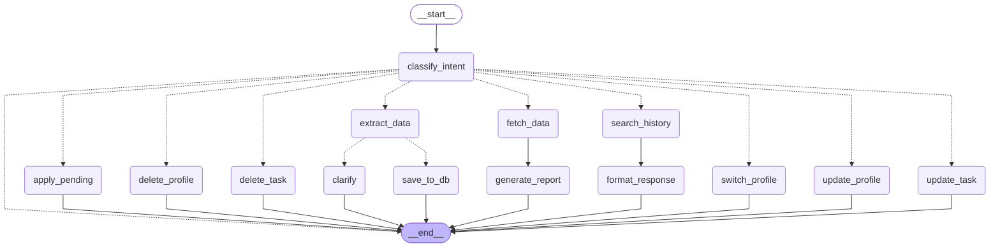

# DUM Agent - Daily Update Management Agent

LangGraph + LangChain + Pydantic + SQLite on **Azure OpenAI**.
Multiple profiles (Ahmad, Wakeel, ...), each with its own updates, history and reports (PDF).

## Structure
```
dum-agent/
├── main.py              # CLI entry point
├── streamlit_app.py     # Streamlit UI (chat, logbook, graph, reports)
├── .streamlit/config.toml  # dark theme colours
├── dum_agent/
│   ├── config.py        # paths + env (Azure OpenAI)
│   ├── llm.py           # AzureChatOpenAI factory
│   ├── schemas.py       # Pydantic models
│   ├── state.py         # AgentState
│   ├── database.py      # profiles + daily_logs (scoped per profile)
│   ├── ui_theme.py      # CSS + week ribbon / logbook HTML builders
│   ├── logger.py        # step-by-step terminal logs
│   ├── pdf_report.py    # Markdown -> PDF
│   ├── task_ops.py      # find / delete / update specific tasks
│   ├── prompts.py       # all system prompts
│   ├── utils.py         # dates, hours, fast routing, error messages
│   ├── nodes.py         # graph nodes + routers
│   ├── graph.py         # StateGraph + MemorySaver
│   └── cli.py           # while-True chat loop
├── tests/test_core.py
├── data/                # dum_agent.db (auto-created)
└── reports/<profile>/   # monthly/final reports (.pdf + .md)
```

## Setup (Windows / VS Code terminal)
```bash
python -m venv .venv
.venv\Scripts\activate
pip install -r requirements.txt
copy .env.example .env
python main.py
```
Fill `.env`: `AZURE_OPENAI_API_KEY`, `AZURE_OPENAI_ENDPOINT`, `AZURE_OPENAI_DEPLOYMENT`
(deployment **name**, not model name), optional `AZURE_OPENAI_API_VERSION`.

## Intents
| Intent | Example |
|---|---|
| daily_update | `Aaj Alpha pe login bug fix kiya, 9 se 5` |
| generate_report | `generate my monthly report` |
| query_history | `What did I do last Tuesday?` / `What is my role?` |
| update_profile | `My name is Wakeel, I work as developer at XYZ` (creates or updates, then switches to it) |
| switch_profile | `switch to Ahmad` |
| delete_profile | `delete profile Wakeel` (asks yes/cancel first) |
| delete_task | `delete the CI/CD task from lawgpt` / `remove log #5` (asks yes/cancel first) |
| update_task | `update the CI/CD task in lawgpt to: CI/CD with GitHub Actions` |

Clear messages are routed by keywords (no LLM call); the rest go to the LLM.
Disable with `DUM_FAST_ROUTING=false`.

## Run
```bash
python main.py                   # CLI
streamlit run streamlit_app.py   # Web UI
```
Tests: `pytest`. Debug: F5.

## Profiles
- Every update, question and report uses the **active profile** only.
- CLI: `/profiles`, `/use <name>`. Streamlit: profile dropdown in the sidebar.
- Reports: `generate my monthly report` (last 30 days) or `generate my final report` (all logs).
- Old single-profile DBs are migrated automatically (old logs go to the old profile, or 'Default').

## Delete / update
- Everything is scoped to the active profile; other profiles are never touched.
- Deletes always ask for confirmation. If several tasks match, a numbered list is shown: reply `2` or `1,3`.
- Deleting the last task of an update removes the whole update. `log #N` ids are shown after saving and in the Logs tab.
- Update can change task text, project, date, time in/out, meetings.
- Deleting a profile removes its logs; saved report files in `reports/<name>/` stay.

## Terminal logs
Every action prints its steps in the terminal where you ran `python main.py` or `streamlit run streamlit_app.py`
(intent, LLM calls, DB writes, profile create/update/switch/delete, task add/delete/update, reports).
Set `DUM_LOG_LEVEL=DEBUG` or `WARNING` in `.env` to show more or less.

## Workflow graph
`/graph` in the CLI prints this map; the Streamlit **Graph** tab draws it and highlights the path of your last message.
Terminal: every message prints `Node 1: ... Node 2: ...` and a final `PATH: START -> ... -> END` line.



## Interface
- **Chat**: talk to the agent; the *week ribbon* above shows each day's work as coloured time blocks (one colour per project).
- **Logbook**: stats, a 14-day ribbon, updates grouped by day (with `log #` ids), table view and CSV export.
- **Graph**: the path your last message took through the agent.
- **Reports**: saved PDFs/Markdown per profile.
- Run the app from the project folder so `.streamlit/config.toml` (theme) is loaded.

## Conversation
The agent only does your work log. Say `hello` and it greets you back and asks what to do today.
General questions ("what is AI", jokes, coding help) are politely declined, with a short list of what it can do.
These replies are fixed text: no LLM call, nothing is saved.
If the agent asks follow-up questions, any new request (report, question, switch profile) simply leaves that draft.
It asks at most `DUM_MAX_CLARIFY_ROUNDS` (default 2) follow-up rounds, then drops the draft.
Your profile only changes when you clearly say so (`my name is ...`, `I work at ...`).
